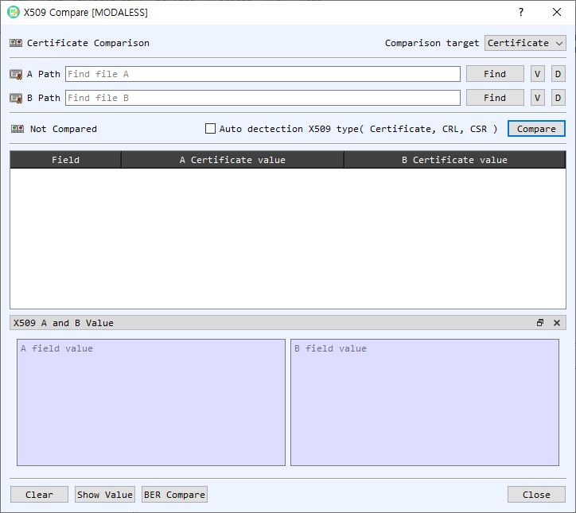

# X.509 Compare

The **X509 Compare** dialog compares two X.509 objects and displays corresponding fields side by side. It supports certificates, certificate revocation lists (CRLs), and certificate signing requests (CSRs).

## Select inputs

| Control | Description |
|---|---|
| Comparison target | Select Certificate, CRL, or CSR. |
| A Path / B Path | Paths to the two input files. You can use **Find** or drop files onto the dialog; dropped files fill A first and then B. |
| Find | Selects an input file matching the chosen comparison type. |
| V | Opens the selected object in its detail viewer. |
| D | Decodes the selected file in the main BerEditor view. |
| Auto detection X509 type | Detects the input object types automatically and disables manual type selection. |
| Compare | Compares the two inputs and populates the results table. |
| Result indicator | Shows whether the objects are the same or different, or that comparison has not yet run. |

The comparison table contains a field name and the values from A and B. Difference indicators mark fields whose values differ. Double-clicking a value opens the corresponding certificate, CRL, or CSR details.

## Inspect field values

Select a row to show its detailed A and B values in the **X509 A and B Value** panel. Use **Show Value** if the panel is hidden. **BER Compare** compares the encoded BER data for the selected objects in BerEditor's BER comparison view.

## Compare two objects

1. Choose the comparison target, or enable automatic X.509 type detection.
2. Select the A and B files with **Find**, or drag and drop them into the dialog. Confirm both paths are populated.
3. Select **Compare**.
4. Review the overall result and compare corresponding fields in the table. Select a row to inspect its detailed values, or double-click a value to open the object's information dialog.
5. Select **BER Compare** to inspect the encoded structures. Use **Clear** to remove both inputs and results, and **Close** when finished.

A and B must contain the same X.509 object type. BerEditor reports a warning if a file cannot be recognized or the selected inputs have different types.
