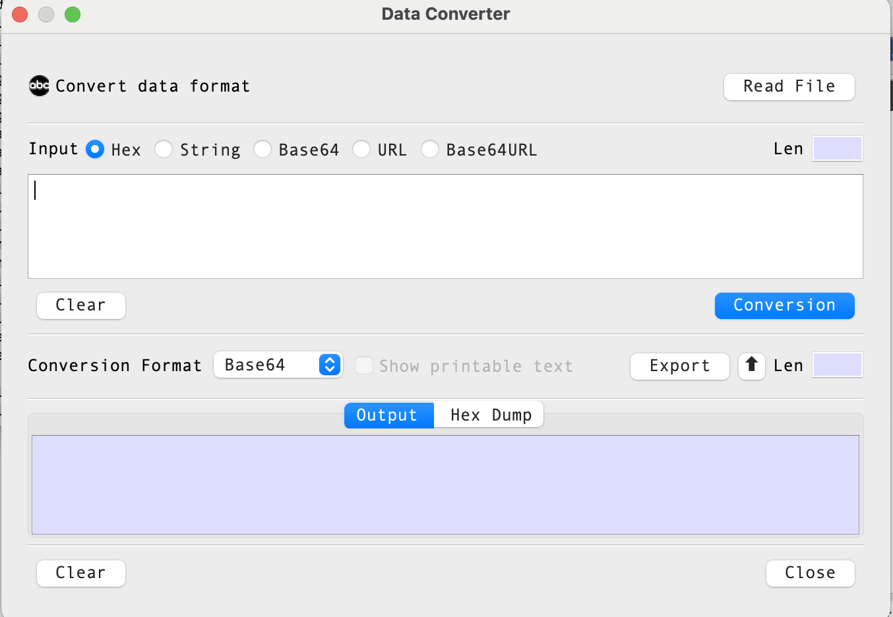

# Data Converter Dialog Guide

The **Data Converter** converts data between text and common encoded representations. Open it from **Tool > Data Converter**.

*Figure 1. Data Converter dialog layout. This is an illustrative diagram based on the UI definition, not a screenshot of the running application.*

### Screen Areas

1. **Read File** — Loads a file into the input area as hexadecimal data.
2. **Input format and input area** — Choose the format of the source data and enter or paste its value.
3. **Input Len** — Shows the length calculated using the selected input format.
4. **Conversion** — Converts the source bytes to the selected output format.
5. **Conversion Format** — Selects the output representation. **Show printable text** is available when **String** is selected.
6. **Export** — Opens the export dialog for the converted bytes.
7. **Up arrow** — Moves the output into the input area and sets the input format to the selected output format.
8. **Output / Hex Dump tabs** — Show the converted text or a hexadecimal dump of its bytes.
9. **Clear / Close** — Clear input or output content, or close the dialog.

## Dialog Controls

| Control | Description |
| --- | --- |
| Read File | Loads a file into the input area as hexadecimal data. Files larger than 1 MB are rejected. |
| Input format | Select how BerEditor should interpret the input: **Hex**, **String**, **Base64**, **URL**, or **Base64URL**. |
| Input area | Enter or paste the source data. |
| Input Len | Read-only length calculated using the selected input format. |
| Clear (input) | Clears the input area. |
| Conversion | Converts the input to the selected output format. |
| Conversion Format | Select the output representation: **Hex**, **String**, **Base64**, **URL**, or **Base64URL**. |
| Show printable text | For **String** output, displays printable characters where possible. This option is unavailable for other output formats. |
| Export | Opens the export dialog to save the converted output as bytes. |
| Up arrow | Copies the current output into the input area and changes the input format to match the selected output format. |
| Output Len | Read-only length calculated using the selected output format. |
| Output tab | Displays the converted output. |
| Hex Dump tab | Displays the converted bytes in a hexadecimal dump with printable characters. |
| Clear (output) | Clears the output and hex dump. |
| Close | Closes the dialog. |

## Convert Data

1. Enter or paste data in the input area, or select **Read File** to load a file.
2. Select the matching input format. For example, choose **Hex** for hexadecimal text or **Base64** for Base64 text.
3. Select the desired **Conversion Format**.
4. If the output format is **String**, optionally select **Show printable text**.
5. Select **Conversion**.
6. Review the result in the **Output** tab. Select **Hex Dump** to inspect the underlying bytes.

The input and output length fields update as the text or format changes. If no input is provided, BerEditor asks you to enter a value. Invalid input for the selected format produces a format error.

## Load a File

1. Select **Read File**.
2. Choose a file in the file picker.
3. BerEditor loads the file bytes into the input area as hexadecimal data and selects **Hex** as the input format.
4. Choose an output format and select **Conversion**.

The file loader accepts files up to 1 MB. Dragging a local file onto the dialog also loads its contents as hexadecimal input.

## Use the Output as New Input

Select the up arrow beside the output format controls. The output text is copied to the input area, and the input format is set to the currently selected output format. The existing output and hex dump are cleared so you can perform another conversion.

## Export Converted Data

Select **Export** to open the export dialog for the converted output. Export is available when the output area contains data. The displayed output is decoded according to the selected output format before it is passed to the export dialog.

## Notes

- **URL** and **Base64URL** are separate formats. Select the one that matches the input or desired output.
- **Show printable text** changes String output rendering; it is disabled for other output formats.
- The **Hex Dump** view shows bytes in 16-byte rows and includes printable characters where available.
- The dialog's output format initially defaults to **Base64**.
