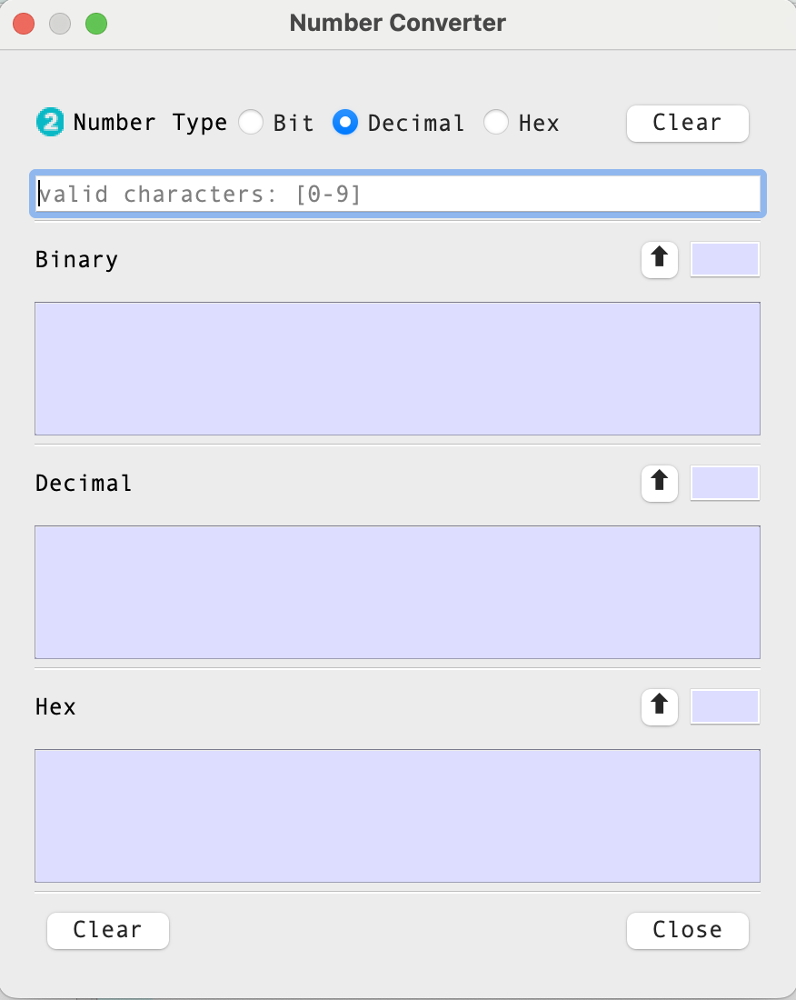

# Number Converter Dialog Guide

The **Number Converter** converts a number between binary, decimal, and hexadecimal representations. Open it from **Tool > Num Converter**.

*Figure 1. Number Converter dialog. Enter a value at the top; the equivalent values appear in the three output sections below.*

## Screen Areas

1. **Number Type** — Select the radix of the value entered in the input field: **Bit** (base 2), **Decimal** (base 10), or **Hex** (base 16). Decimal is selected by default.
2. **Input field** — Enter the value to convert. The placeholder indicates valid characters for the selected type.
3. **Input Clear** — Clears the input field.
4. **Binary output** — Shows the equivalent binary representation. Its length is shown in the small read-only field beside the up-arrow button.
5. **Decimal output** — Shows the equivalent decimal representation and its length.
6. **Hex output** — Shows the equivalent hexadecimal representation and its length.
7. **Up-arrow buttons** — Copy that section's value to the input field and select its matching input type, allowing conversion from that representation.
8. **Output Clear** — Clears all three converted values and their lengths.
9. **Close** — Closes the dialog.

## Convert a Number

1. Select the input **Number Type**.
2. Enter a value in the input field.
3. Read the equivalent values in the Binary, Decimal, and Hex sections. Conversion occurs as you type.
4. To use one of the results as the next input, select the up-arrow button beside that result.

## Input Formats

| Type | Valid digits | Example |
| --- | --- | --- |
| Bit | `0` and `1` | `101101` |
| Decimal | Decimal digits; a minus sign is supported for negative values | `45` or `-12` |
| Hex | `0`–`9`, `A`–`F`, or `a`–`f` | `2D` or `a4` |

Whitespace is removed before conversion. An invalid value triggers a warning. When entering hexadecimal with an odd number of digits, the converter pads a leading zero internally before decoding it.

## Clear Values

- Select the top **Clear** button to clear the input field.
- Select the bottom **Clear** button to clear the Binary, Decimal, and Hex results.
