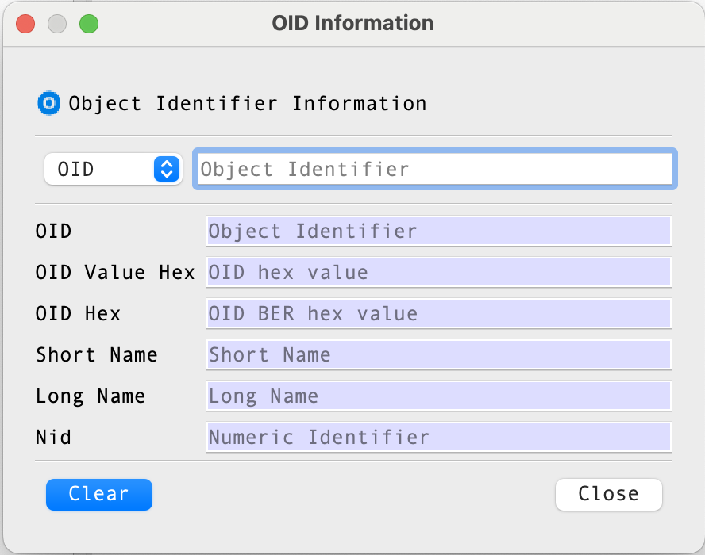

# OID Information Dialog Guide

The **OID Information** dialog looks up Object Identifier (OID) details from an OID or one of its supported representations. Open it from **Tool > OID Information**.

*Figure 1. OID Information dialog. Choose an input representation and enter its value; the matching fields are populated as you type.*

## Screen Areas

1. **Input type** — Select the representation of the value to search for.
2. **Input field** — Enter the value. The placeholder text changes to indicate the expected input.
3. **OID** — Displays the dotted-decimal object identifier.
4. **OID Value Hex** — Displays the hexadecimal encoding of the OID value.
5. **OID Hex** — Displays the BER-encoded OID in hexadecimal form.
6. **Short Name** — Displays the OID's short name, when available.
7. **Long Name** — Displays the OID's long name, when available.
8. **Nid** — Displays the numeric identifier (NID), when available.
9. **Clear** — Clears the displayed result fields.
10. **Close** — Closes the dialog.

The lookup runs as you type or change the input type. The result fields are read-only.

## Supported Input Types

| Input type | What to enter | Example format |
| --- | --- | --- |
| `OID` | Dotted-decimal OID | `1.2.840.113549.1.1.1` |
| `OIDValueHex` | Hexadecimal OID value bytes | Hexadecimal characters, for example `2A864886F70D010101` |
| `OIDHex` | BER-encoded OID bytes in hexadecimal | Hexadecimal characters, for example `06092A864886F70D010101` |
| `ShortName` | OID short name | For example, `rsaEncryption` |
| `LongName` | OID long name | Enter the name used by the OID database. |
| `Nid` | Numeric identifier | A numeric NID value. |

## Look Up an OID

1. Choose the appropriate input type from the selector.
2. Enter or paste the corresponding value in the input field.
3. Read the resolved OID and any available associated values below.
4. Select **Clear** to clear the result fields before another lookup, or replace the input to search again.

If a name or NID is not known to the OID database, some result fields may remain blank. The dialog does not provide a separate Search button; lookup is triggered by changes to the input.

## Notes

- `OIDValueHex` and `OIDHex` are different: `OIDHex` includes the BER tag and length bytes, while `OIDValueHex` contains the OID value bytes.
- Short name, long name, and NID are shown only when the underlying OID database has corresponding entries.
- The dialog also contains a **Create** action in the UI definition, but it is hidden by the current application implementation; it is therefore not part of the visible workflow shown above.
